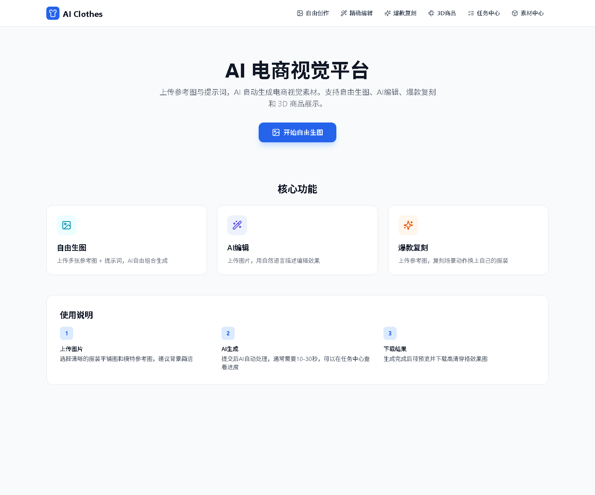
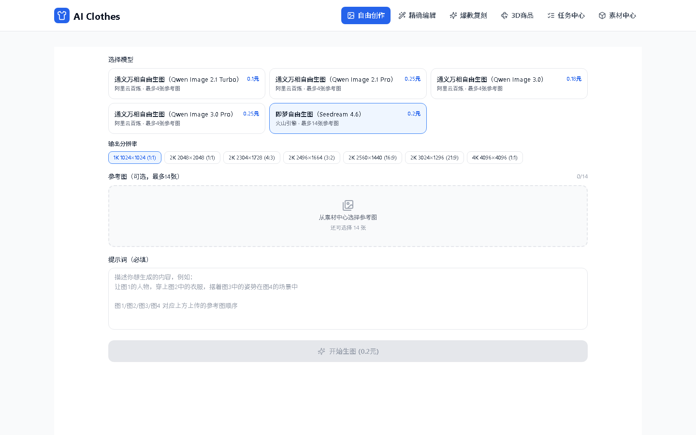
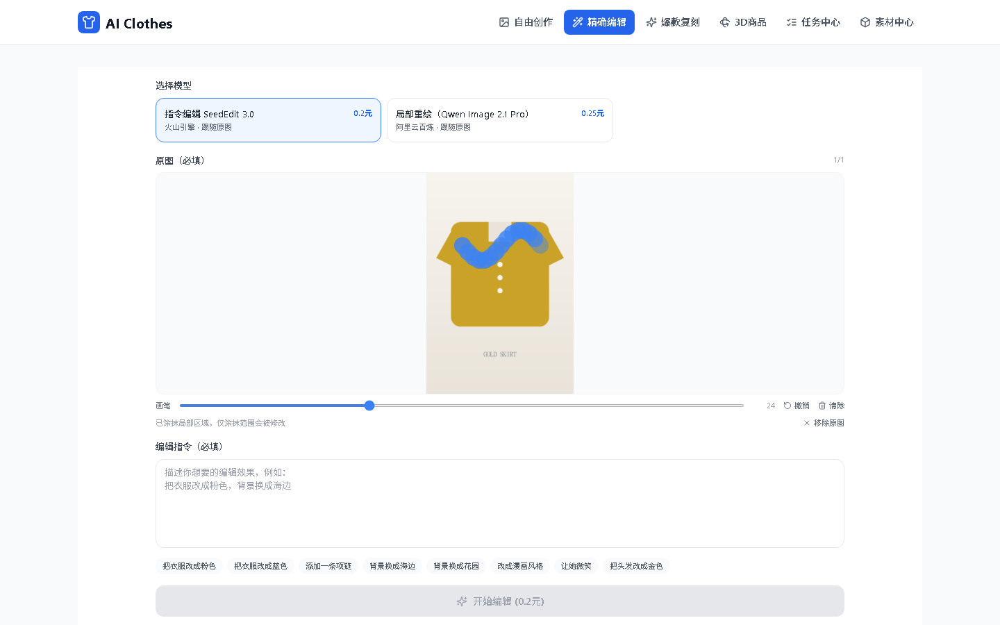
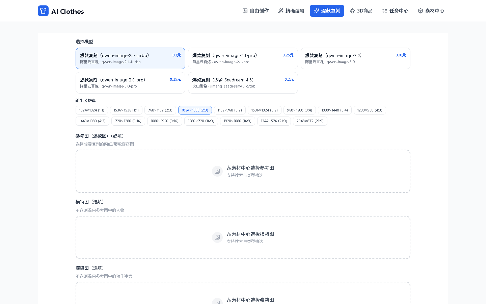
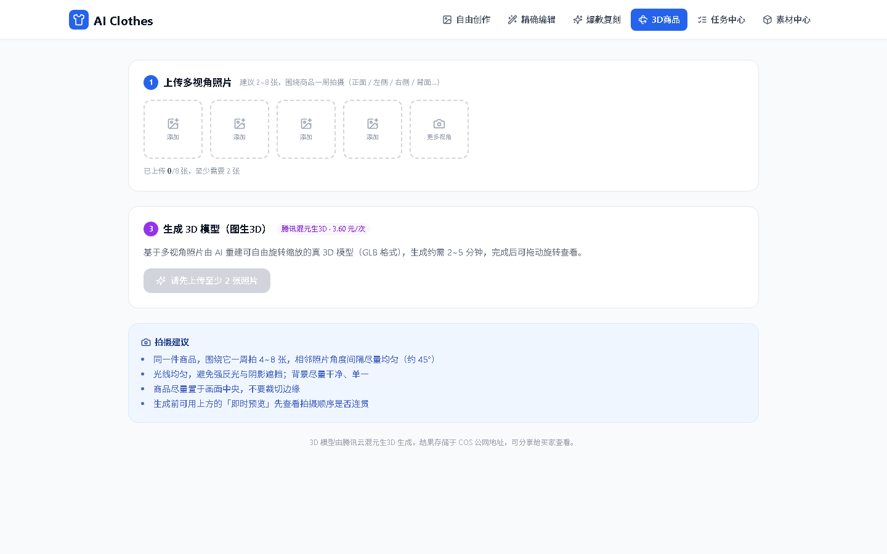
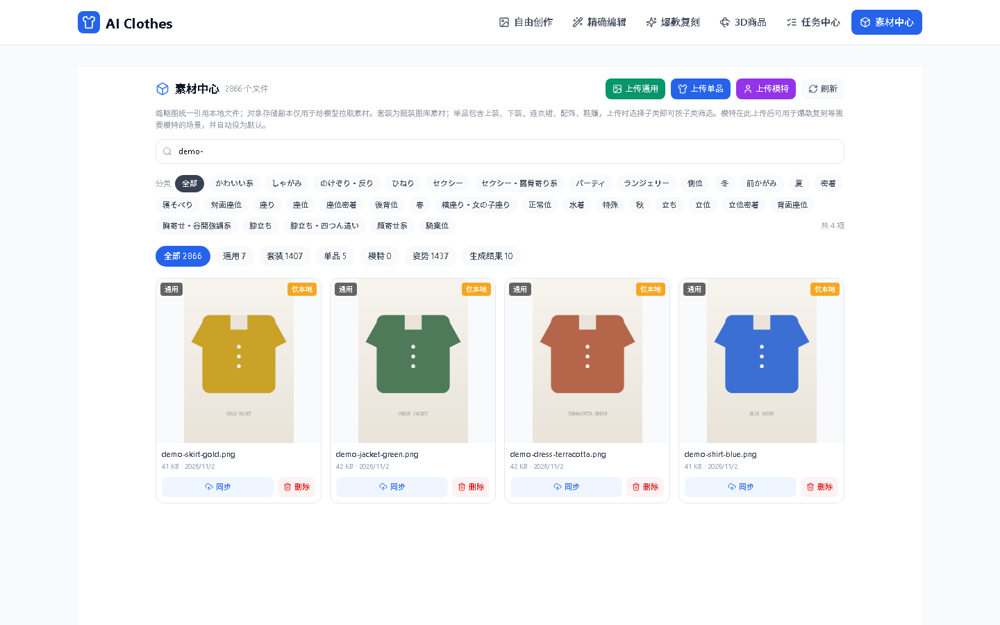

# AI Clothes — AI 电商视觉平台

基于 AI 的电商视觉生产平台：上传参考图与提示词即可生成电商视觉素材，并延伸出数字人模特、爆款复刻与 3D 商品模型能力。



## 功能矩阵

导航栏共 6 个入口，对应 5 个业务模块 + 1 个任务中心。

| 模块 | 路由 | 说明 | 底层能力 |
|------|------|------|---------|
| 自由生图 | `/generate` | 上传多张参考图（qwen 最多 4 张 / 即梦最多 14 张）+ 提示词，AI 自由组合生成 | 阿里云 qwen-image / 即梦 Seedream |
| AI 编辑 | `/edit` | 上传单张图并涂抹局部区域（可选），用自然语言描述编辑效果 | 火山引擎 SeedEdit 3.0（裁切局部精修后贴回）/ 阿里云 qwen-image-2.1-pro（局部裁切编辑后贴回） |
| 素材中心 | `/assets` | 浏览与检索素材、上传套装/单品（上装/下装/连衣裙/配饰/鞋履）、上传模特、导入图库、同步/删除 | — |
| 3D 商品 | `/model3d` | 上传 2–8 张多视角照片，生成可拖拽的 GLB 模型 | 腾讯混元生3D（`hy-3d-3.1`） |
| 爆款复刻 | `/replicate` | 上传爆款参考图，复刻其场景与姿态并替换服装 | 阿里云百炼 qwen-image / 火山引擎即梦 Seedream 4.6 |
| 任务中心 | `/tasks` | 全部异步任务的状态、进度、结果与重试入口 | — |

## 界面预览

| 自由生图 | 精确编辑（涂抹局部） |
| --- | --- |
|  |  |
| **爆款复刻** | **3D 商品** |
|  |  |
| **素材中心** | **首页** |
|  |  |

## 技术栈

| 层级 | 选型 | 说明 |
|------|------|------|
| 框架 | Next.js 14.2（App Router） | 全栈一体，API Routes + Client Components |
| 语言 | TypeScript 5.6 | 严格类型，`@/` 别名指向 `src/` |
| 数据库 | SQLite + better-sqlite3 | 同步 API、零配置、单文件；WAL 模式 |
| 样式 | Tailwind CSS 3.4 + lucide-react | 原子化样式，图标统一用 lucide |
| 图片存储 | 本地 + 对象存储（腾讯云 COS / 阿里云 OSS） | 用户上传素材先落本地，再同步对象存储提供公网 URL；生成结果只存本地 |
| 图片处理 | sharp | 服务端缩放/裁切/掩膜羽化/拼图（涂抹局部编辑贴回） |
| 3D 渲染 | `<model-viewer>`（CDN）+ CSS 3D Transform | GLB 用 model-viewer，三视图用纯 CSS 旋转 |
| 任务队列 | 进程内轮询 + SQLite 持久化 | 不引入 Redis，单进程内并发调度 |

## 快速开始

```bash
# 1. 安装依赖
npm install

# 2. 配置环境变量
cp .env.example .env.local   # 按需填入各厂商密钥

# 3. 启动开发服务器
rm -rf .next && npm run dev   # 首次启动或改过 config 时先清缓存，见「避坑」第 1 条
# Windows PowerShell 用：Remove-Item -Recurse -Force .next; npm run dev
```

打开 <http://localhost:3000>。数据库在首次请求时自动创建于 `data/aiclothes.db`，无需手动迁移。

环境要求：Node.js 18+（推荐 20 LTS）。`better-sqlite3` 与 `sharp` 走预编译包，Node 大版本升级后如报原生模块错误，执行 `npm rebuild better-sqlite3 sharp`。

生产构建：

```bash
npm run build && npm start
```

## 目录结构

```
AIClothes/
├── data/
│   └── aiclothes.db                 # SQLite 数据库（WAL，含 -wal/-shm 附属文件）
├── docs/                            # 设计与 API 调研笔记、预览截图
├── public/
│   ├── default-models/              # 预置模特图（当前为空）
│   └── uploads/
│       ├── cache/                   # /api/image-cache 的本地图片缓存
│       ├── general/                 # 通用素材
│       ├── garment/                 # 套装素材
│       ├── item/                    # 单品素材（上装/下装/连衣裙/配饰/鞋履）
│       ├── model/                   # 模特素材
│       ├── pose/                    # 姿势素材与编辑掩膜
│       ├── background/              # 背景素材
│       ├── results/                 # AI 生成结果（仅本地）
│       ├── model3d/                 # 生成的 GLB 与预览图（仅本地）
│       └── garments|models|poses|backgrounds|accessories/  # 早期目录遗留，可清理
├── src/
│   ├── app/
│   │   ├── layout.tsx               # 根布局（顶栏 + 导航）
│   │   ├── page.tsx                 # 首页功能入口
│   │   ├── generate/                # 自由生图
│   │   ├── edit/                    # AI 编辑
│   │   ├── model3d/                 # 3D 商品（混元生3D）
│   │   ├── replicate/               # 爆款复刻
│   │   ├── assets/                  # 素材中心（上传模特 / 图库素材）
│   │   ├── tasks/                   # 任务中心
│   │   └── api/                     # 见「API 参考」
│   ├── components/
│   │   ├── layout/header-nav.tsx    # 顶部导航（桌面 + 移动）
│   │   ├── upload/image-upload.tsx  # 图片上传组件
│   │   ├── assets/                  # 素材选择器（素材中心 / 各生成页共用）
│   │   ├── edit/mask-painter.tsx    # 涂抹画布（生成外接框 + 黑白掩膜）
│   │   ├── task-status/task-status.tsx  # 任务状态与进度
│   │   └── viewer/
│   │       ├── multi-view-3d.tsx    # 三视图 CSS 3D 旋转
│   │       └── spin-360.tsx         # 帧序列 360° 预览
│   ├── lib/
│   │   ├── ai/
│   │   │   ├── generation-plans.ts  # ★ 生成方案目录（厂商/模型/单价/分辨率）
│   │   │   ├── tencent.ts           # 腾讯云 MPS（遗留换装接口）
│   │   │   ├── hunyuan.ts           # 腾讯混元生图（遗留图生图）
│   │   │   ├── tencent3d.ts         # 腾讯混元生3D（异步 GLB）
│   │   │   ├── volcengine.ts        # 火山引擎（即梦 Seedream / SeedEdit）
│   │   │   └── aliyun.ts            # 阿里云百炼 qwen-image
│   │   ├── queue/
│   │   │   ├── index.ts             # 调度器（轮询取任务 + 超时恢复）
│   │   │   ├── task-store.ts        # tasks 表读写
│   │   │   ├── reconcile.ts         # 失败任务向厂商回查并恢复
│   │   │   └── workers/
│   │   │       ├── tryon.ts         # 单图任务（复刻/编辑/生图）
│   │   │       └── model3d.ts       # 3D 模型
│   │   ├── db/
│   │   │   ├── index.ts             # 单例连接 + 惰性建表 + 轻量迁移
│   │   │   ├── schema.ts            # 建表 DDL
│   │   │   ├── model-store.ts       # 模特
│   │   │   ├── garment-store.ts     # 服装单品
│   │   │   └── image-generation-store.ts  # 单图生成记录
│   │   ├── storage/
│   │   │   ├── cos.ts               # 统一存储入口（按 STORAGE_PROVIDER 选 COS/OSS）
│   │   │   ├── aliyun-oss.ts        # 阿里云 OSS 适配
│   │   │   ├── local.ts             # 本地落盘（素材副本 + 生成结果）
│   │   │   ├── assets.ts            # 素材扫描 / 同步 / 删除
│   │   │   └── material-types.ts    # 素材类型与前端共享常量
│   │   └── utils/                   # cn / cacheImageUrl / file / id
│   └── types/index.ts               # 全局类型定义
├── next.config.js
├── tailwind.config.ts
└── .env.example
```

## 生成方案目录

`src/lib/ai/generation-plans.ts` 是整个 AI 层的单一事实来源：前端通过
`GET /api/generation-plans?purpose=<类型>` 拉取可选项，后端按 `planId` 路由到对应厂商接口。
新增模型只需在 `GENERATION_PLANS` 数组追加一项，业务代码无需改动。

**未传 `planId` 时取该任务类型的第一个方案**（数组中顺序决定默认值）。

### 爆款复刻（`replicate`）

| 方案 ID | 厂商 | 模型 | 单价 |
|---------|------|------|------|
| `aliyun-replicate-qwen-image` ← 默认 | 阿里云百炼 | qwen-image-2.1-turbo | 0.10 |
| `aliyun-replicate-qwen-image-2-pro` | 阿里云百炼 | qwen-image-2.1-pro | 0.25 |
| `aliyun-replicate-qwen-image-3` | 阿里云百炼 | qwen-image-3.0 | 0.18 |
| `aliyun-replicate-qwen-image-3-pro` | 阿里云百炼 | qwen-image-3.0-pro | 0.25 |
| `volcengine-replicate-jimeng` | 火山引擎 | jimeng_seedream46_cvtob | 0.20 |

### 3D 商品（`model3d`）

| 方案 ID | 厂商 | 模型 | 单价 | 输出 |
|---------|------|------|------|------|
| `tencent-model3d-hunyuan` | 腾讯云 混元生3D | hy-3d-3.1 | 3.60 | GLB（可开 PBR） |

### AI 编辑（`edit`）

| 方案 ID | 厂商 | 模型 | 单价 |
|---------|------|------|------|
| `volcengine-seedit-v3` ← 默认 | 火山引擎 | seededit_v3.0 | 0.20 |
| `aliyun-qwen-edit-2-pro` | 阿里云百炼 | qwen-image-2.1-pro | 0.25 |

> 两个方案都支持前端涂抹局部区域，最终效果一致：SeedEdit 与 qwen-image 都先按涂抹范围裁切编辑，
> 再按涂抹掩膜羽化贴回原图；qwen-image 会按选区比例选择最接近的官方输出尺寸。不涂抹时按整图编辑。

### 自由生图（`generate`）

| 方案 ID | 厂商 | 模型 | 单价 | 最大参考图 |
|---------|------|------|------|-----------|
| `aliyun-qwen-free` ← 默认 | 阿里云百炼 | qwen-image-2.1-turbo | 0.10 | 4 |
| `aliyun-qwen-free-2-pro` | 阿里云百炼 | qwen-image-2.1-pro | 0.25 | 4 |
| `aliyun-qwen-free-3` | 阿里云百炼 | qwen-image-3.0 | 0.18 | 4 |
| `aliyun-qwen-free-3-pro` | 阿里云百炼 | qwen-image-3.0-pro | 0.25 | 4 |
| `volcengine-jimeng-free` | 火山引擎 | jimeng_seedream46_cvtob | 0.20 | 14 |

> 表中的 `price` / `calls` 用于**成本核算与前端展示**，不是厂商实时账单。调价时同步修改
> `generation-plans.ts` 即可，历史记录已落库不受影响。

## 异步任务架构

所有 AI 调用一律异步，接口只负责建任务并立刻返回 `taskId`。

```
前端提交
   ↓
POST /api/xxx → 校验参数 → 查生成方案（厂商/模型/价格）
   ↓
createTask() 写入 tasks 表（status=pending，params 含 planMeta）
   ↓ 立即返回 { taskId }
前端每 2s 轮询 GET /api/tasks/:id
   ↓
Worker 每 2s 取任务（并发上限 3）→ 置 processing
   ↓
worker 按 params.method 分发到厂商 → 轮询第三方（3s/次）
   ↓
下载结果图 → 落本地 public/uploads/results（3D 落 model3d/）→ 写生成记录 → 置 completed / failed
   ↓
前端拿到 completed → 展示结果
```

**关键机制**

- **Worker 懒启动**：`startWorker()` 幂等（`workerStarted` 标记），由各写接口的 `ensureWorkerStarted()` 触发，避免 Next 热重载重复起定时器。
- **并发控制**：`CONCURRENCY = 3`，`activeTasks` Set 去重，同一任务不会被并发执行两次。
- **超时自愈**：每 30s 扫一次 processing 超过阈值的任务。
  - 多步任务（`model3d`）→ 重置为 `pending` 续跑，凭 `provider_task_id` 继续轮询，**不重复提交、不二次计费**。
  - 单步任务 → 直接向厂商查真实状态，FINISH 则收尾，FAILED 则标失败。
- **手动恢复**：`POST /api/tasks/:id/reconcile` 主动回查厂商，带 30s 节流（`RECONCILE_THROTTLE_MS`），避免前端轮询打爆厂商接口。
- **重试**：`PATCH /api/tasks/:id` 仅对 `failed` 任务生效，重置为 pending 并清空 `provider_task_id`。

## 数据库设计

5 张表，全部为 `TEXT`/`INTEGER`/`REAL` 基础类型，数组字段以 JSON 字符串存储。

| 表 | 用途 |
|----|------|
| `models` | 模特/数字人，`identity_image_path` 为人像原图，`is_default` 标记默认模特 |
| `garments` | 服装单品，`category` ∈ top/bottom/dress/accessories/shoes，`tags` 为 JSON 数组 |
| `asset_metadata` | 素材中心元数据（标题/分类/关键词/来源），与上传文件按 `type + filename` 关联 |
| `image_generations` | 单图级生成历史（复刻/3D/自由生图） |
| `tasks` | 统一异步任务表，`params`/`result` 为 JSON，`provider_task_id` 用于续跑 |

```sql
CREATE TABLE IF NOT EXISTS tasks (
  id TEXT PRIMARY KEY,
  type TEXT NOT NULL,            -- replicate | model3d | edit | generate
  status TEXT NOT NULL,          -- pending | processing | completed | failed
  params TEXT NOT NULL,          -- JSON：业务入参 + planMeta（planId/provider/model/price/calls）
  result TEXT,                   -- JSON：{ images: [...], glbUrl?, previewUrl? }
  error TEXT,
  progress INTEGER DEFAULT 0,
  provider_task_id TEXT,         -- 厂商侧任务 ID，用于超时续跑
  provider TEXT,                 -- tencent | aliyun | volcengine
  created_at INTEGER NOT NULL,
  updated_at INTEGER NOT NULL,
  completed_at INTEGER
);
```

**迁移策略**：`CREATE TABLE IF NOT EXISTS` 不会改动已存在的表，因此 `migrateDb()` 用
`PRAGMA table_info` 检测缺列后 `ALTER TABLE ADD COLUMN`，目前覆盖 `models.is_default`。
新增列时按同样方式追加。

## API 参考

共 15 个路由。除 `/api/assets`（声明 `runtime = 'nodejs'`）外，均显式设置 `export const dynamic = 'force-dynamic'`，避免任务与素材状态被缓存。

### 上传与图片

| 方法 | 路径 | 说明 |
|------|------|------|
| POST | `/api/upload` | `multipart/form-data`：`file` + `type`（general/garment/item/model/pose/background）。校验图片类型与 `MAX_FILE_SIZE`，超过 1920px 等比缩放；素材先落本地再同步对象存储，返回 `{ id, path, url, publicPath, filename }` |
| GET | `/api/image-cache?url=` | 图片本地缓存代理，URL 的 MD5 为文件名，命中直接返回并带 `max-age=86400`；非 http(s) 直接 302 |

### 素材中心

| 方法 | 路径 | 说明 |
|------|------|------|
| GET | `/api/assets?type=` | 扫描本地素材目录，返回文件名、大小、时间、分类、关键词与对象存储同步状态 |
| POST | `/api/assets` | `{ type, filename }` 同步到对象存储；`{ action: 'metadata', ... }` 写入素材元数据（标题/分类/来源/标签） |
| DELETE | `/api/assets?type=&filename=` | 删除素材：本地文件 + 对象存储副本（`results` 仅删本地） |

### 生成任务（均返回 `{ taskId }`）

| 方法 | 路径 | 入参要点 |
|------|------|---------|
| POST | `/api/replicate` | `referenceImagePath`（必填）+ 可选 `modelImagePath` `poseImagePath` `garmentImagePath` `scenePrompt` `planId` `outputResolution`；按 `planId` 路由阿里云 qwen-image（4 档）或火山引擎即梦 Seedream 4.6，选填图按 模特→姿势→服装 顺序追加，指令按实际选填项动态生成 |
| POST | `/api/generate` | `imagePaths[]` + `prompt`，可选 `planId` `outputResolution`（`WxH` 或 `original`），按 `plan.maxImages` 截断 |
| POST | `/api/edit` | `garmentImagePath` + `prompt`，可选 `planId` `region` `maskDataUrl`；`region` 为归一化涂抹外接框，`maskDataUrl` 为同尺寸黑白 PNG，两者缺一时按整图编辑 |
| POST | `/api/3d/generate` | `imageUrls[]`（前端要求 2–8 张），可选 `resultFormat`（默认 GLB）`enablePbr` `planId` |

**分辨率处理**：前端传 `"1080x1440"` 时，即梦按 `w*h` 换算像素总数并归类到 1K/2K/4K，
阿里云按 `"W*H"` 字符串透传；传 `"original"` 则标记为「原图」不做限制。

### 模特

| 方法 | 路径 | 说明 |
|------|------|------|
| GET | `/api/model` | 列表 + `defaultModel` |
| POST | `/api/model` | `name` + `identityImagePath`，可选 `avatarPath` `gender` |
| GET | `/api/model/:id` | 详情 |
| PATCH | `/api/model/:id` | 传 `{ setDefault: true }` 设为默认（互斥） |
| DELETE | `/api/model/:id` | 删除 |

### 服装单品

| 方法 | 路径 | 说明 |
|------|------|------|
| GET | `/api/garment?category=` | 列表，可按品类过滤 |
| POST | `/api/garment` | `name` + `category` + `imagePath`，可选 `color` `tags` |

### 生成方案

| 方法 | 路径 | 说明 |
|------|------|------|
| GET | `/api/generation-plans?purpose=` | 生成方案列表，`purpose` ∈ `replicate`/`model3d`/`edit`/`generate` |

### 任务与历史

| 方法 | 路径 | 说明 |
|------|------|------|
| GET | `/api/tasks` | 无 `page` 时返回最近 100 条；带 `page`&`pageSize`（5/10/20/40/80）时分页，支持 `type` 过滤。会顺带把对象形态的 `result.images` 规范化为数组 |
| GET | `/api/tasks/:id` | 单任务状态（`id/type/status/progress/result/error/createdAt/completedAt`） |
| PATCH | `/api/tasks/:id` | 仅 `failed` 可重试，重置为 pending 并清空 `provider_task_id` |
| DELETE | `/api/tasks/:id` | 删除任务记录 |
| POST | `/api/tasks/:id/reconcile` | 向厂商回查并恢复失败/卡住的任务 |
| GET | `/api/image-generations?type=` | 单图生成历史，`type` ∈ `replicate`/`model3d`/`generate` |

### 响应示例

```jsonc
// GET /api/tasks/:id
{
  "id": "task_mspr9hlocp3w7c",
  "type": "replicate",
  "status": "completed",
  "progress": 100,
  "result": { "images": ["https://.../uploads/results/xxx.jpg"] },
  "error": null,
  "createdAt": 1723000000000,
  "completedAt": 1723000020000
}
```

## 页面说明

| 页面 | 交互要点 |
|------|---------|
| `/` 首页 | 3 个功能卡片（自由生图 / AI 编辑 / 爆款复刻）+ 三步使用说明 |
| `/generate` 自由生图 | 多图上传位（按方案 `maxImages` 限制），提示词支持「图1/图2…」指代上传顺序，可选输出分辨率 |
| `/edit` AI 编辑 | 单图 + 提示词，图片上涂抹局部区域（可调画笔、撤销、清除），内置快捷指令（QUICK_PROMPTS）一键填充 |
| `/assets` 素材中心 | 类型标签 + 分类/关键词检索；上传模特（自动设为默认、可切换默认、删除）；图库素材同步与删除 |
| `/model3d` 3D 商品 | 2–8 张多视角上传 → 即时帧序列预览 → 生成后用 `<model-viewer>` 拖拽查看 GLB |
| `/replicate` 爆款复刻 | 参考图必填，模特/姿势/服装图选填（按组合动态生成指令），可选输出分辨率 |
| `/tasks` 任务中心 | 分页列表、状态筛选、失败重试、手动恢复 |

## 环境变量

```env
# ── 腾讯云（MPS 换装、混元生图、混元生3D、COS 共用同一组密钥）──
TENCENT_SECRET_ID=
TENCENT_SECRET_KEY=
TENCENT_MPS_REGION=ap-guangzhou

# ── 对象存储（二选一，配一组即可）──
STORAGE_PROVIDER=tencent         # tencent（COS）| aliyun（OSS），默认 tencent
# 腾讯云 COS
TENCENT_COS_BUCKET=
TENCENT_COS_REGION=ap-guangzhou
TENCENT_COS_PUBLIC_URL=          # 可选，自定义 CDN 域名；留空用 https://{bucket}.cos.{region}.myqcloud.com
# 阿里云 OSS
ALIYUN_OSS_ACCESS_KEY_ID=
ALIYUN_OSS_ACCESS_KEY_SECRET=
ALIYUN_OSS_BUCKET=
ALIYUN_OSS_REGION=oss-cn-hangzhou
ALIYUN_OSS_PUBLIC_URL=           # 可选，留空用 https://{bucket}.{region}.aliyuncs.com

# ── 火山引擎（即梦 Seedream 4.6 / SeedEdit 3.0）──
VOLCENGINE_ACCESS_KEY=
VOLCENGINE_SECRET_KEY=
VOLCENGINE_REGION=cn-north-1

# ── 阿里云百炼（qwen-image 系列）──
ALIYUN_BAILIAN_API_KEY=
ALIYUN_BAILIAN_REGION=cn-beijing
ALIYUN_BAILIAN_BASE_URL=         # sk-ws- 工作空间密钥必须填专属 Host，否则回退公共 DashScope

# ── 应用 ──
UPLOAD_DIR=public/uploads
MAX_FILE_SIZE=10485760           # 10MB
NEXT_PUBLIC_APP_URL=http://localhost:3000
```

> 至少需要配置**一组**可用厂商密钥。只配置部分厂商时，前端仍会列出未配置的方案，
> 选中后任务会在 worker 阶段因鉴权失败而报错——建议按实际开通的账号裁剪 `GENERATION_PLANS`。

## 技术决策与避坑

1. **启动前先清 `.next`**：`next dev` 在部分环境下会复用损坏的编译缓存（改过 `next.config.js` / `tailwind.config.ts` 后尤其常见）。先删 `.next` 再启动；带删除保护的环境（如沙箱/安全垫片）可能报 `SAFE_DELETE_BULK_CONFIRM_REQUIRED`，需要手动删除该目录。
2. **数据库惰性初始化**：不在模块顶层执行 DDL，首次 `getDb()` 时才建表，避免构建期副作用与热重载重复执行。
3. **better-sqlite3 原生模块**：使用包内 `prebuilds/win32-x64.node` 等预编译产物，跨版本 Node 升级后如报绑定错误执行 `npm rebuild better-sqlite3`。
4. **Server / Client 边界**：除首页（纯静态 Server Component）外，其余 6 个页面均为 `'use client'`，数据统一通过 `/api/*` 获取；不要在 Client Component 里直接 import `lib/db`。
5. **JSON 字段**：SQLite 无数组类型，统一用 `TEXT` 存 JSON，经 `parseJson`/`stringifyJson` 转换。
6. **素材必须公网可访问**：厂商侧是拉取 URL 而非接收文件流，所以用户上传的素材会先落本地、再同步到 COS/OSS；`resolveUrl()` 负责把历史遗留的 `/uploads/xxx` 相对路径补成对象存储公网地址。
7. **素材与结果分开存储**：生成结果只落本地 `public/uploads/results`（3D 落 `model3d/`），不回传对象存储；`public/uploads` 同时保存 `image-cache` 缓存，容器部署需挂载持久卷。
8. **计费安全**：多步任务恢复时优先复用 `provider_task_id` 续轮询，绝不对已提交的视角重新下单。
9. **成本可追溯**：每次生成都把 `provider/model/price/calls` 写入生成记录表，任务失败也会留痕，便于对账。

## 已知问题与待办

- 首页 `src/app/page.tsx` 只有 3 个功能卡片，缺少导航里已有的「3D商品 `/model3d`」与「素材中心 `/assets`」入口。
- `public/default-models/` 为空目录，预置模特库能力实际未启用。
- `public/uploads` 下保留 `garments|models|poses|backgrounds|accessories` 等早期目录，与新目录并存，可在确认无引用后清理。
- 任务队列为进程内实现，仅适合单实例部署；多实例需改为外部队列（Redis/DB 轮询锁）。
- 无鉴权与用户体系，所有数据全局共享，上线前需补充登录与数据隔离。
